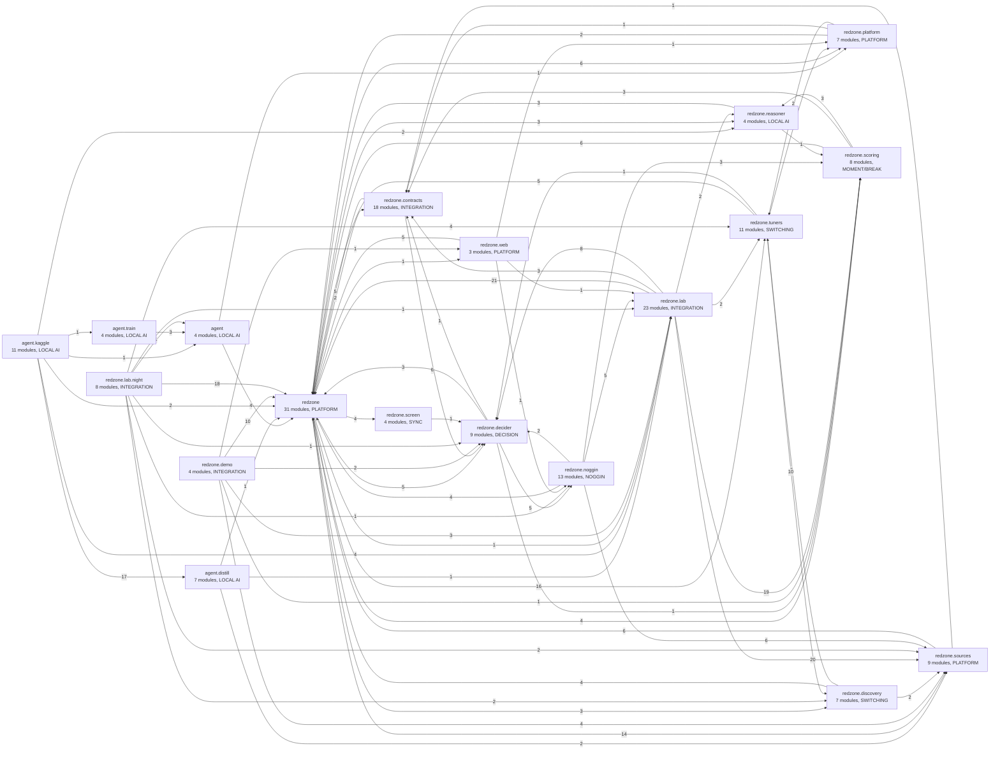

# City map

Generated by `scripts/citymap.py` from the imports and `redzone/contracts/map.py` (do not edit by hand; northstar.yml regenerates it). Every module, what it reads, who uses it, who owns it, and the contract checks of `scripts/contract_check.py` (CI).

**185 modules, 56,391 lines, 571 import edges. Contract violations: 31** (boundary 6, dead 1, defined-twice 13, orphan 2, second-scoring-path 2, timing-literal 7). `json.loads` call sites: 122.

## Districts

Each box is a package; an arrow is one district importing another (the number is how many import edges).

## Contract violations

| rule | where | owner (lane) | what |
|---|---|---|---|
| boundary | `agent/kaggle/build_moments_kaggle.py:109` | LOCAL AI (1) | ESPN only in sources/ |
| boundary | `agent/train/make_data.py:58` | LOCAL AI (1) | ESPN only in sources/ |
| boundary | `agent/train/make_data.py:62` | LOCAL AI (1) | NHL api only in sources/ |
| boundary | `redzone/autonomy.py:527` | PLATFORM (4) | the TV's HDMI-CEC only in control/tuners |
| boundary | `redzone/autonomy.py:85` | PLATFORM (4) | ESPN only in sources/ |
| boundary | `redzone/views.py:23` | PLATFORM (4) | ESPN only in sources/ |
| dead | `redzone/tuners/identity.py` | SWITCHING (3) | reached only from tests (1 files), no entry point uses it |
| defined-twice | `redzone/decider/decider.py:122` | DECISION (2) | VISIT_MIN_S is also defined in redzone.scoring.breaks |
| defined-twice | `redzone/demo/engine.py:43` | INTEGRATION (4) | FEED_LAG_S is also defined in redzone.lab.night.run |
| defined-twice | `redzone/lab/night/run.py:37` | INTEGRATION (4) | FEED_LAG_S is also defined in redzone.demo.engine |
| defined-twice | `redzone/platform/breaker.py:25` | PLATFORM (4) | MAX_BACKOFF_S is also defined in redzone.sources.fastcast, redzone.sources.http |
| defined-twice | `redzone/scoring/breaks.py:51` | MOMENT/BREAK (1) | VISIT_MIN_S is also defined in redzone.decider.decider |
| defined-twice | `redzone/screen/boundary.py:37` | SYNC (2) | MIN_SAMPLE_S is also defined in redzone.screen.scorebug |
| defined-twice | `redzone/screen/boundary.py:38` | SYNC (2) | MAX_SAMPLE_S is also defined in redzone.screen.scorebug |
| defined-twice | `redzone/screen/boundary.py:40` | SYNC (2) | MAX_GAP_S is also defined in redzone.screen.scorebug |
| defined-twice | `redzone/screen/scorebug.py:30` | SYNC (2) | MIN_SAMPLE_S is also defined in redzone.screen.boundary |
| defined-twice | `redzone/screen/scorebug.py:31` | SYNC (2) | MAX_SAMPLE_S is also defined in redzone.screen.boundary |
| defined-twice | `redzone/screen/scorebug.py:34` | SYNC (2) | MAX_GAP_S is also defined in redzone.screen.boundary |
| defined-twice | `redzone/sources/fastcast.py:94` | PLATFORM (4) | MAX_BACKOFF_S is also defined in redzone.platform.breaker, redzone.sources.http |
| defined-twice | `redzone/sources/http.py:32` | PLATFORM (4) | MAX_BACKOFF_S is also defined in redzone.platform.breaker, redzone.sources.fastcast |
| orphan | `agent/kaggle/teacher_distill.py` | LOCAL AI (1) | nothing imports it and it is no entry point |
| orphan | `redzone/lab/night/presses.py` | INTEGRATION (4) | nothing imports it and it is no entry point |
| second-scoring-path | `redzone/demo/engine.py` | INTEGRATION (4) | redzone.demo.engine imports the scorer redzone.scoring.drive (route it through Watch Value) |
| second-scoring-path | `redzone/web/phone_v2.py` | PLATFORM (4) | redzone.web.phone_v2 imports the scorer redzone.noggin.priority (route it through Watch Value) |
| timing-literal | `agent/distill/jump.py:34` | LOCAL AI (1) | SWITCH_S = 5.5: a timing cost belongs in measured config (timing.* / calib.*) |
| timing-literal | `redzone/control.py:106` | SWITCHING (3) | FLIP_DEADLINE_S = 4.5: a timing cost belongs in measured config (timing.* / calib.*) |
| timing-literal | `redzone/control.py:80` | SWITCHING (3) | FLIP_SETTLE_S = 3: a timing cost belongs in measured config (timing.* / calib.*) |
| timing-literal | `redzone/control.py:88` | SWITCHING (3) | TV_FLIP_MAX_S = 6: a timing cost belongs in measured config (timing.* / calib.*) |
| timing-literal | `redzone/decider/decider.py:212` | DECISION (2) | TUNE_SLACK_S = 3: a timing cost belongs in measured config (timing.* / calib.*) |
| timing-literal | `redzone/demo/engine.py:45` | INTEGRATION (4) | TUNE_S = 5: a timing cost belongs in measured config (timing.* / calib.*) |
| timing-literal | `redzone/standby.py:234` | SWITCHING (3) | ShadowStick.FLIP_S = 3: a timing cost belongs in measured config (timing.* / calib.*) |

## Modules

Reads: the modules it imports, the config sections it reads (`cfg.get("section.key")`) and data files it names. Used by: modules of ours that import it (+ scripts, tests). ⚠ = a contract violation, ✝ = no entry point reaches it.

### agent

| module | owner | lines | reads | config | data | used by |
|---|---|---:|---|---|---|---|
| `agent` | LOCAL AI | 1 | – | – | – | – (+8 tests) |
| `llm` | LOCAL AI | 36 | governor | – | – | agent.train.evaluate, agent.watchdog |
| `policy` | LOCAL AI | 359 | jsonfind | – | – | agent.kaggle.grade, agent.train.evaluate, agent.train.make_data, agent.watchdog (+8 tests) |
| `watchdog` | LOCAL AI | 569 | agent.llm, agent.policy, governor, memory, platform.autofix | – | agent.jsonl | lab.night.run (+7 tests) |

### agent.distill

| module | owner | lines | reads | config | data | used by |
|---|---|---:|---|---|---|---|
| `agent.distill` | LOCAL AI | 12 | – | – | – | agent.kaggle.build_moments_kaggle, agent.kaggle.grade, agent.kaggle.pack_data, agent.kaggle.student_data (+1 scripts, 2 tests) |
| `evaluate` | LOCAL AI | 269 | agent.distill.gold, agent.distill.jump, agent.distill.teacher | – | – | agent.kaggle.grade (+1 scripts, 2 tests) |
| `gold` | LOCAL AI | 118 | agent.distill.jump | – | – | agent.distill.evaluate, agent.kaggle.build_moments_kaggle, agent.kaggle.pack_data |
| `jump` ⚠ | LOCAL AI | 299 | lab.sportsdata, models, sources, sources.espn | – | – | agent.distill.evaluate, agent.distill.gold, agent.kaggle.grade, agent.kaggle.pack_data |
| `split` | LOCAL AI | 138 | – | – | – | agent.kaggle.build_moments_kaggle, agent.kaggle.pack_data (+2 tests) |
| `student` | LOCAL AI | 116 | agent.distill.teacher | – | – | agent.kaggle.student_data (+1 scripts, 1 tests) |
| `teacher` | LOCAL AI | 404 | – | – | – | 7 modules (+1 scripts, 1 tests) |

### agent.kaggle

| module | owner | lines | reads | config | data | used by |
|---|---|---:|---|---|---|---|
| `agent.kaggle` | LOCAL AI | 1 | – | – | – | – (+4 tests) |
| `build_moments_kaggle` ⚠ | LOCAL AI | 449 | agent.distill, agent.distill.gold, agent.distill.split, config, lab, lab.backtest, lab.reasoner_data, lab.sportsgrade, models, reasoner, reasoner.brief | – | – | – |
| `build_notebook` | LOCAL AI | 56 | – | – | – | – (+2 tests) |
| `constrained` | LOCAL AI | 272 | – | – | – | agent.kaggle.run_students (+1 tests) |
| `dequant` | LOCAL AI | 100 | – | – | – | agent.kaggle.run_students (+1 tests) |
| `grade` | LOCAL AI | 280 | agent.distill, agent.distill.evaluate, agent.distill.jump, agent.distill.teacher, agent.policy | – | grade_rows.jsonl, jump_rows.jsonl, rows_test.jsonl, rows_valid.jsonl, teacher_out.jsonl, test_out.jsonl, test_out_base.jsonl | – (+1 tests) |
| `pack_data` | LOCAL AI | 285 | agent.distill, agent.distill.gold, agent.distill.jump, agent.distill.split, agent.distill.teacher | – | chat_test.jsonl, jump_gold.jsonl, lock_gold.jsonl, test.jsonl, train.jsonl, valid.jsonl | – (+2 tests) |
| `run_students` | LOCAL AI | 470 | agent.distill.teacher, agent.kaggle.constrained, agent.kaggle.dequant, agent.kaggle.student_data, agent.train.peft_to_mlx | – | test.jsonl, test_out.jsonl, test_out_base.jsonl, train.jsonl, valid.jsonl | – (+2 tests) |
| `run_teacher` | LOCAL AI | 269 | – | – | teacher_out.jsonl | agent.kaggle.teacher_distill (+1 tests) |
| `student_data` | LOCAL AI | 244 | agent.distill, agent.distill.student, agent.distill.teacher | – | jump_rows.jsonl, lock_gold.jsonl, test.jsonl, train.jsonl, valid.jsonl | agent.kaggle.run_students |
| `teacher_distill` ⚠ ✝ | LOCAL AI | 316 | agent.distill.teacher, agent.kaggle.run_teacher | – | grade_rows.jsonl, jump_rows.jsonl, teacher_out.jsonl, teacher_requests.jsonl, test_out.jsonl, test_out_base.jsonl | – |

### agent.train

| module | owner | lines | reads | config | data | used by |
|---|---|---:|---|---|---|---|
| `agent.train` | LOCAL AI | 1 | – | – | – | – |
| `evaluate` | LOCAL AI | 55 | agent.llm, agent.policy | – | – | – |
| `make_data` ⚠ | LOCAL AI | 173 | agent.policy | – | – | – |
| `peft_to_mlx` | LOCAL AI | 122 | – | – | – | agent.kaggle.run_students |

### redzone

| module | owner | lines | reads | config | data | used by |
|---|---|---:|---|---|---|---|
| `redzone` | INTEGRATION | 1 | – | – | – | 6 modules (+10 scripts, 48 tests) |
| `__main__` | PLATFORM | 97 | config, engine, web.server | mode, server | – | demo.__main__ (+1 scripts, 2 tests) |
| `autonomy` ⚠ | PLATFORM | 2156 | channels, config, control, discovery.yttv, governor, models, network, tuners.adb, tuners.tuners | autonomy | autonomy.jsonl | discovery.runtime, lab.night.run, tvsetup (+3 tests) |
| `bets` | DECISION | 83 | models | – | – | engine (+1 tests) |
| `calibration` | SWITCHING | 149 | – | calib, two_stick | – | engine, supervisor (+1 tests) |
| `channels` | SWITCHING | 368 | models | – | – | 12 modules (+7 scripts, 28 tests) |
| `commands` | SWITCHING | 79 | – | – | – | engine (+1 tests) |
| `config` | INTEGRATION | 274 | – | – | – | 17 modules (+15 scripts, 34 tests) |
| `control` ⚠ | SWITCHING | 2884 | channels, tuners, tuners.adb, tuners.prime_multiview, tuners.tuners, tv | buffer, decider, hardening, mode, replay, timing, tuners, two_stick | – | 5 modules (+3 scripts, 29 tests) |
| `engine` | INTEGRATION | 2279 | redzone, bets, calibration, channels, commands, config, control, decider.decider, decider.screen, decider.sync, discovery.runtime, fantasy, governor, lab.timing, models, network, plan, platform.agent_fix, platform.wake, reasoner, reasoner.brief, reasoner.reasoner, recorded, recorder, reel, scoring, scoring.breaks, scoring.drive, scoring.engine, screen, screen.audio, screen.boundary, screen.scorebug, screen_ocr, sources, sources.espn, sources.eventlinks, sources.fastcast, sources.fastcast_check, sources.feeds, sources.http, sources.leagues, sources.merge, standby, store, supervisor, sync_probe, trace, tuners, tuners.prime_multiview, userstate, views | brain, college, control, decider, delay, fantasy, hardening, mode, polling, reasoner, reel, replay, score, screen, sources, switch_speed, sync, timing, tuners, two_stick | agent.jsonl, buffer.jsonl, sync.jsonl, traces.jsonl | __main__, demo.engine, lab.night.run, web.server (+2 scripts, 27 tests) |
| `fantasy` | DECISION | 136 | models, tv | – | – | engine (+1 tests) |
| `governor` | PLATFORM | 433 | – | – | – | 7 modules (+1 scripts, 2 tests) |
| `jsonfind` | PLATFORM | 76 | – | – | – | agent.policy, reasoner.reasoner (+1 tests) |
| `memory` | PLATFORM | 151 | – | – | – | agent.watchdog (+1 scripts, 1 tests) |
| `models` | INTEGRATION | 210 | – | – | – | 56 modules (+11 scripts, 61 tests) |
| `network` | PLATFORM | 586 | – | – | – | autonomy, engine, lab.night.run, tvsetup (+1 scripts, 2 tests) |
| `observability` | PLATFORM | 302 | redzone, supervisor, trace | – | agent.jsonl, supervisor.jsonl, supervisor_cuts.jsonl, supervisor_moments.jsonl | supervisor (+1 tests) |
| `plan` | DECISION | 461 | channels, models | mode, plan, warmup | – | engine, lab.night.run (+1 scripts, 1 tests) |
| `recorded` | PLATFORM | 246 | screen_ocr, tuners.adb, tuners.prime_search | mode, providers | – | engine (+1 scripts, 1 tests) |
| `recorder` | PLATFORM | 142 | models, sources, sources.espn, sources.leagues | – | nhl_seen.jsonl, plays.jsonl, race.jsonl, sync_anchors.jsonl | engine, lab.night.run (+5 tests) |
| `reel` | DECISION | 565 | governor | reel, score | – | engine, lab.night.run (+1 tests) |
| `screen_ocr` | SYNC | 318 | governor | – | – | 8 modules (+3 scripts, 5 tests) |
| `standby` ⚠ | SWITCHING | 299 | models | two_stick | – | demo.engine, engine (+4 tests) |
| `store` | PLATFORM | 186 | – | – | redzone.db | 5 modules (+2 scripts, 25 tests) |
| `supervisor` | PLATFORM | 1483 | redzone, calibration, channels, config, contracts.health, control, decider.decider, decider.screen, discovery.providers, models, observability, platform.agent_fix, platform.autofix, platform.health, store, trace, tuners, tuners.adb, tuners.providers, tuners.screen_prompts | control, delay, mode, supervisor | supervisor.jsonl, supervisor_cuts.jsonl, supervisor_moments.jsonl | engine, lab.night.run, observability, trace (+2 scripts, 6 tests) |
| `sync_probe` | SYNC | 253 | tuners.adb | mode, sync | sync_probe.jsonl | engine (+2 tests) |
| `trace` | PLATFORM | 302 | contracts.trace, store, supervisor | – | – | engine, observability, supervisor (+2 tests) |
| `tv` | SWITCHING | 767 | platform.breaker | – | tv_input.jsonl | control, fantasy, lab.night.run, tvsetup (+2 scripts, 5 tests) |
| `tvsetup` | SWITCHING | 603 | redzone, autonomy, network, tuners.adb, tv | – | – | – (+2 scripts, 1 tests) |
| `userstate` | DECISION | 93 | – | – | – | engine (+1 tests) |
| `views` ⚠ | PLATFORM | 160 | models, sources, sources.espn | – | – | demo.engine, engine, sources.fastcast (+1 tests) |

### redzone.contracts

| module | owner | lines | reads | config | data | used by |
|---|---|---:|---|---|---|---|
| `redzone.contracts` | INTEGRATION | 89 | contracts.breaks, contracts.budget, contracts.clock, contracts.feeds, contracts.flags, contracts.guard, contracts.health, contracts.moment, contracts.reasoner, contracts.reel, contracts.switching, contracts.sync, contracts.trace, contracts.views, contracts.world, decider.core | – | – | lab.citymap (+1 scripts, 3 tests) |
| `breaks` | INTEGRATION | 58 | models | – | – | 5 modules |
| `budget` | INTEGRATION | 46 | – | – | – | contracts |
| `clock` | INTEGRATION | 48 | contracts.sync | – | – | contracts, contracts.views, contracts.world |
| `feeds` | INTEGRATION | 42 | models | – | – | contracts, contracts.world, sources.feeds (+1 tests) |
| `flags` | INTEGRATION | 60 | – | – | – | contracts |
| `guard` | INTEGRATION | 42 | contracts.trace, decider.core | – | – | contracts |
| `health` | INTEGRATION | 62 | – | – | – | contracts, contracts.world, platform.health, supervisor (+1 tests) |
| `legacy` | INTEGRATION | 105 | contracts.breaks, contracts.moment, contracts.sync, decider.core, decider.decider, models | – | – | scoring.brain3 (+1 tests) |
| `map` | INTEGRATION | 116 | – | – | – | lab.citymap (+1 scripts) |
| `moment` | INTEGRATION | 44 | models | – | – | 5 modules |
| `reasoner` | INTEGRATION | 45 | – | – | – | contracts, contracts.views, contracts.world |
| `reel` | INTEGRATION | 49 | – | – | – | contracts, contracts.views, contracts.world |
| `switching` | INTEGRATION | 98 | decider.core | – | – | contracts, contracts.world, lab.evaldata (+2 tests) |
| `sync` | INTEGRATION | 43 | – | – | – | 6 modules |
| `trace` | INTEGRATION | 60 | – | – | – | contracts, contracts.guard, trace |
| `views` | INTEGRATION | 61 | contracts.breaks, contracts.clock, contracts.moment, contracts.reasoner, contracts.reel, contracts.sync, decider.core | – | – | contracts |
| `world` | INTEGRATION | 84 | contracts.breaks, contracts.clock, contracts.feeds, contracts.health, contracts.moment, contracts.reasoner, contracts.reel, contracts.switching, contracts.sync, models | – | – | contracts |

### redzone.decider

| module | owner | lines | reads | config | data | used by |
|---|---|---:|---|---|---|---|
| `redzone.decider` | DECISION | 1 | – | – | – | decider.decider, lab.tune, noggin.features (+1 scripts, 6 tests) |
| `core` | DECISION | 399 | – | – | – | 7 modules (+2 tests) |
| `cuts` | DECISION | 557 | models | – | – | decider.decider, decider.screen, noggin.features (+1 scripts, 7 tests) |
| `decider` ⚠ | DECISION | 2240 | decider, decider.core, decider.cuts, decider.playbooks, decider.scenarios, decider.screen, models, noggin, noggin.live, noggin.lookahead, noggin.pick, noggin.wire, scoring.engine | brain, decider, noggin, playbooks, polling, reasoner, redzone_mode, reel, replay | – | 7 modules (+1 scripts, 32 tests) |
| `delaymodel` | DECISION | 110 | – | – | – | decider.screen (+1 tests) |
| `playbooks` | DECISION | 140 | – | playbooks, polling | – | decider.decider, decider.scenarios (+1 tests) |
| `scenarios` | DECISION | 147 | decider.playbooks | decider, playbooks | – | decider.decider (+2 tests) |
| `screen` | DECISION | 944 | decider.cuts, decider.delaymodel, decider.sync, models | – | – | 9 modules (+1 scripts, 32 tests) |
| `sync` | DECISION | 409 | contracts.sync | – | – | decider.screen, engine, screen.scorebug (+2 tests) |

### redzone.demo

| module | owner | lines | reads | config | data | used by |
|---|---|---:|---|---|---|---|
| `redzone.demo` | INTEGRATION | 1 | – | – | – | – (+1 scripts) |
| `__main__` | INTEGRATION | 116 | __main__, demo.download, demo.engine, lab.evaldata, web.server | – | – | – |
| `download` | INTEGRATION | 43 | – | – | – | demo.__main__ |
| `engine` ⚠ | INTEGRATION | 569 | redzone, channels, config, control, decider.decider, decider.screen, engine, lab, lab.backtest, models, scoring.drive, sources, sources.espn, sources.feeds, sources.merge, standby, store, views | decider, delay | – | demo.__main__ (+1 tests) |

### redzone.discovery

| module | owner | lines | reads | config | data | used by |
|---|---|---:|---|---|---|---|
| `redzone.discovery` | SWITCHING | 8 | – | – | – | discovery.search, discovery.yttv, lab.night.run, tuners.yttv_search (+2 scripts, 3 tests) |
| `lounge` | SWITCHING | 209 | – | – | – | discovery.yttv (+1 scripts) |
| `providers` | SWITCHING | 1042 | channels, models | – | – | 10 modules (+2 scripts, 6 tests) |
| `runtime` | SWITCHING | 146 | autonomy, discovery.providers, tuners.providers, tuners.tuners | autonomy, mode, providers | – | engine (+3 tests) |
| `search` | SWITCHING | 240 | discovery, discovery.providers, discovery.stickio, discovery.yttv | – | – | discovery.yttv (+1 tests) |
| `stickio` | SWITCHING | 342 | discovery.providers, tuners.adb, tuners.profiles | – | – | discovery.search, discovery.yttv, tuners.yttv_search (+2 tests) |
| `yttv` | SWITCHING | 701 | channels, discovery, discovery.lounge, discovery.search, discovery.stickio, sources, sources.eventlinks, tuners.adb | – | – | 5 modules (+1 scripts, 2 tests) |

### redzone.lab

| module | owner | lines | reads | config | data | used by |
|---|---|---:|---|---|---|---|
| `redzone.lab` | INTEGRATION | 1 | – | – | – | 13 modules (+21 scripts, 24 tests) |
| `backtest` | INTEGRATION | 1002 | channels, config, decider.decider, decider.screen, lab, lab.cutgrade, lab.timing, models, scoring.drive, scoring.engine, sources, sources.espn | delay, polling, sync | – | 11 modules (+5 scripts, 11 tests) |
| `brain3cal` | MOMENT/BREAK | 157 | lab.brain3data, scoring, scoring.brain, scoring.brain3 | – | – | – (+1 scripts, 1 tests) |
| `brain3data` | MOMENT/BREAK | 318 | lab, lab.datasets, lab.sportsdata, scoring.brain3 | – | – | lab.brain3cal, lab.brain3fit (+1 scripts, 1 tests) |
| `brain3fit` | MOMENT/BREAK | 357 | lab, lab.brain3data, lab.brainfit, models, scoring, scoring.brain, scoring.brain3, scoring.breaks, sources, sources.espn | – | – | – (+1 scripts) |
| `brainfit` | MOMENT/BREAK | 273 | config, lab, lab.datasets, models, scoring, scoring.brain, scoring.breaks, scoring.engine, sources, sources.espn | – | – | lab.brain3fit, lab.breakblend (+2 scripts) |
| `breakblend` | MOMENT/BREAK | 211 | config, lab, lab.brainfit, lab.datasets, lab.splits, models, scoring, scoring.brain, scoring.breaks, sources, sources.espn | – | – | – (+1 scripts, 1 tests) |
| `citymap` | INTEGRATION | 240 | contracts, contracts.map | – | – | – (+2 scripts, 1 tests) |
| `cutgrade` | INTEGRATION | 266 | decider.screen, lab.backtest, lab.sportsgrade, models, sources, sources.espn | – | – | lab.backtest, lab.oracle, lab.sportsgrade, noggin.pick (+1 scripts, 3 tests) |
| `datasets` | INTEGRATION | 122 | – | – | – | lab.brain3data, lab.brainfit, lab.breakblend, lab.sportsdata (+2 scripts, 2 tests) |
| `decision_records` | INTEGRATION | 189 | – | – | supervisor_cuts.jsonl, supervisor_moments.jsonl | web.phone_v2 (+1 scripts, 1 tests) |
| `evaldata` | INTEGRATION | 160 | config, contracts.switching | – | – | demo.__main__ (+7 scripts, 3 tests) |
| `optimize` | INTEGRATION | 129 | config, lab.backtest, models | teams | – | lab.tune (+1 scripts, 2 tests) |
| `oracle` | INTEGRATION | 215 | lab, lab.backtest, lab.cutgrade, lab.sportsgrade, models, sources, sources.espn | – | – | noggin.pick (+3 scripts, 1 tests) |
| `prime_mv_fake` | INTEGRATION | 142 | tuners, tuners.prime_multiview | – | – | – (+1 scripts, 1 tests) |
| `reasoner_data` | LOCAL AI | 163 | config, lab, lab.backtest, lab.sportsgrade, models, reasoner, reasoner.brief, scoring.engine, sources, sources.espn | – | – | agent.kaggle.build_moments_kaggle (+4 scripts) |
| `replaycheck` | INTEGRATION | 227 | config, decider.screen, lab, lab.backtest, lab.sportsgrade, models, sources, sources.espn | decider | – | – (+1 scripts, 1 tests) |
| `splits` | INTEGRATION | 125 | – | – | – | lab.breakblend, lab.tune (+4 scripts, 4 tests) |
| `sportsdata` | INTEGRATION | 805 | lab.datasets, models, scoring.gameflow, sources, sources.espn | – | – | agent.distill.jump, lab.brain3data (+1 scripts, 3 tests) |
| `sportsgrade` | INTEGRATION | 289 | decider.screen, lab, lab.backtest, lab.cutgrade, models, sources, sources.espn | – | – | 7 modules (+3 scripts, 4 tests) |
| `syncsim` | INTEGRATION | 286 | decider.screen | – | – | – (+1 scripts, 1 tests) |
| `timing` | INTEGRATION | 344 | – | sources | – | engine, lab.backtest (+1 scripts, 4 tests) |
| `tune` | INTEGRATION | 477 | config, decider, decider.decider, lab, lab.backtest, lab.optimize, lab.splits, lab.sportsgrade, models | decider, teams | – | – (+1 scripts, 1 tests) |

### redzone.lab.night

| module | owner | lines | reads | config | data | used by |
|---|---|---:|---|---|---|---|
| `redzone.lab.night` | INTEGRATION | 11 | – | – | – | lab.night.__main__, lab.night.faults, lab.night.run (+1 scripts, 8 tests) |
| `__main__` | INTEGRATION | 61 | lab.night, lab.night.run, lab.night.vclock | – | – | – |
| `faults` | INTEGRATION | 422 | lab.night, lab.night.house | – | – | lab.night.presses, lab.night.run (+2 tests) |
| `house` | INTEGRATION | 710 | screen_ocr, tuners, tuners.adb | – | – | lab.night.faults, lab.night.run (+1 tests) |
| `presses` ⚠ ✝ | INTEGRATION | 405 | lab.night.faults, models, noggin.profile | – | – | – |
| `run` ⚠ | INTEGRATION | 925 | agent.watchdog, redzone, autonomy, channels, config, control, decider.decider, discovery, discovery.yttv, engine, governor, lab.backtest, lab.night, lab.night.faults, lab.night.house, lab.night.smartthings, lab.night.vclock, models, network, plan, recorder, reel, screen_ocr, sources, sources.espn, store, supervisor, tuners, tuners.screen_prompts, tv | control, hardening, playbooks, polling | agent.jsonl, redzone.db, screen.jsonl, supervisor.jsonl, tv_input.jsonl | lab.night.__main__ (+1 scripts, 7 tests) |
| `smartthings` | INTEGRATION | 83 | – | – | – | lab.night.run (+1 tests) |
| `vclock` | INTEGRATION | 160 | – | – | – | lab.night.__main__, lab.night.run (+1 tests) |

### redzone.noggin

| module | owner | lines | reads | config | data | used by |
|---|---|---:|---|---|---|---|
| `redzone.noggin` | NOGGIN | 2 | – | – | – | 5 modules (+6 scripts, 7 tests) |
| `factory` | NOGGIN | 292 | models, noggin.features, sources, sources.espn | – | – | – (+2 scripts, 1 tests) |
| `features` | NOGGIN | 171 | decider, decider.cuts, models, sources, sources.espn | – | – | 7 modules (+2 tests) |
| `live` | NOGGIN | 143 | models, noggin, noggin.features, noggin.predict, noggin.timing | noggin | – | decider.decider (+1 tests) |
| `lookahead` | NOGGIN | 51 | – | – | – | decider.decider (+1 tests) |
| `pick` | NOGGIN | 323 | lab, lab.backtest, lab.cutgrade, lab.oracle, lab.sportsgrade, models, noggin.features, noggin.timing, scoring.brain3, sources, sources.espn | – | – | decider.decider (+2 scripts, 1 tests) |
| `predict` | NOGGIN | 80 | noggin.features, noggin.timing | – | – | noggin.live, noggin.predict_fit (+1 scripts, 1 tests) |
| `predict_fit` | NOGGIN | 151 | noggin, noggin.features, noggin.predict, noggin.timing_fit, scoring.brain3 | – | – | – (+1 scripts, 1 tests) |
| `priority` | NOGGIN | 227 | – | core, noggin | – | noggin.wire, web.phone_v2 (+2 tests) |
| `profile` | NOGGIN | 66 | – | – | – | lab.night.presses (+1 scripts, 3 tests) |
| `timing` | NOGGIN | 224 | noggin.features, scoring.brain3 | – | – | noggin.live, noggin.pick, noggin.predict, noggin.timing_fit (+1 scripts, 1 tests) |
| `timing_fit` | NOGGIN | 150 | noggin, noggin.features, noggin.timing | – | – | noggin.predict_fit (+1 scripts) |
| `wire` | NOGGIN | 40 | noggin, noggin.priority | – | – | decider.decider |

### redzone.platform

| module | owner | lines | reads | config | data | used by |
|---|---|---:|---|---|---|---|
| `redzone.platform` | PLATFORM | 2 | – | – | – | – (+1 tests) |
| `agent_fix` | PLATFORM | 138 | models | hardening | – | engine, supervisor, web.server (+1 tests) |
| `autofix` | PLATFORM | 294 | – | – | agent.jsonl, filed.jsonl, redzone.db, supervisor.jsonl, traces.jsonl | agent.watchdog, supervisor (+1 tests) |
| `breaker` ⚠ | PLATFORM | 101 | – | – | – | tuners.adb, tv (+3 tests) |
| `faults` | PLATFORM | 183 | tuners.adb, tuners.tuners | – | – | – (+1 scripts, 2 tests) |
| `health` | PLATFORM | 200 | contracts.health, models | control | – | supervisor (+1 scripts, 2 tests) |
| `wake` | PLATFORM | 90 | – | – | – | engine (+1 tests) |

### redzone.reasoner

| module | owner | lines | reads | config | data | used by |
|---|---|---:|---|---|---|---|
| `redzone.reasoner` | LOCAL AI | 17 | – | – | – | 6 modules (+2 scripts, 1 tests) |
| `brief` | LOCAL AI | 231 | models | – | – | 6 modules (+1 scripts, 1 tests) |
| `head` | LOCAL AI | 81 | reasoner, reasoner.brief, scoring.brain | – | – | reasoner.reasoner (+2 scripts, 1 tests) |
| `reasoner` | LOCAL AI | 294 | jsonfind, models, reasoner, reasoner.brief, reasoner.head | – | – | engine, scoring.engine (+2 scripts, 2 tests) |

### redzone.scoring

| module | owner | lines | reads | config | data | used by |
|---|---|---:|---|---|---|---|
| `redzone.scoring` | MOMENT/BREAK | 1 | – | – | – | 9 modules (+4 scripts, 7 tests) |
| `brain` | MOMENT/BREAK | 740 | models, scoring, scoring.brain3, scoring.gameflow | brain | – | 7 modules (+4 scripts, 2 tests) |
| `brain3` | MOMENT/BREAK | 459 | contracts.breaks, contracts.legacy, contracts.moment, models, scoring, scoring.brain, scoring.breaks | – | – | 7 modules (+1 tests) |
| `breaks` ⚠ | MOMENT/BREAK | 348 | models | – | – | 6 modules (+6 tests) |
| `drive` | DECISION | 209 | models, scoring, scoring.breaks, scoring.engine | redzone_mode | – | demo.engine, engine, lab.backtest (+1 tests) |
| `engine` | DECISION | 835 | models, reasoner, reasoner.brief, reasoner.reasoner, scoring, scoring.brain, scoring.garbage | brain, reasoner, score | – | 6 modules (+21 tests) |
| `gameflow` | DECISION | 121 | – | – | – | lab.sportsdata, scoring.brain |
| `garbage` | DECISION | 70 | models | – | – | scoring.engine (+2 tests) |

### redzone.screen

| module | owner | lines | reads | config | data | used by |
|---|---|---:|---|---|---|---|
| `redzone.screen` | SYNC | 1 | – | – | – | engine (+1 tests) |
| `audio` | SYNC | 117 | – | – | – | engine (+1 tests) |
| `boundary` ⚠ | SYNC | 286 | – | – | – | engine (+1 tests) |
| `scorebug` ⚠ | SYNC | 371 | decider.sync | – | – | engine (+1 tests) |

### redzone.sources

| module | owner | lines | reads | config | data | used by |
|---|---|---:|---|---|---|---|
| `redzone.sources` | PLATFORM | 1 | – | – | – | 21 modules (+5 scripts, 16 tests) |
| `espn` | PLATFORM | 722 | models | – | – | 21 modules (+4 scripts, 12 tests) |
| `eventlinks` | PLATFORM | 716 | – | – | – | discovery.yttv, engine (+2 scripts, 2 tests) |
| `fastcast` ⚠ | PLATFORM | 1249 | models, sources, sources.espn, views | – | – | engine (+2 tests) |
| `fastcast_check` | PLATFORM | 229 | – | – | – | engine (+1 scripts, 2 tests) |
| `feeds` | PLATFORM | 91 | contracts.feeds, models, sources.http, sources.merge | – | – | demo.engine, engine (+1 scripts, 2 tests) |
| `http` ⚠ | PLATFORM | 162 | – | – | – | engine, sources.feeds (+2 scripts, 3 tests) |
| `leagues` | PLATFORM | 356 | models, sources.espn | – | – | engine, recorder (+4 tests) |
| `merge` | PLATFORM | 289 | models | – | – | demo.engine, engine, sources.feeds (+1 scripts, 6 tests) |

### redzone.tuners

| module | owner | lines | reads | config | data | used by |
|---|---|---:|---|---|---|---|
| `redzone.tuners` | SWITCHING | 1 | – | – | – | 7 modules (+3 scripts, 15 tests) |
| `adb` | SWITCHING | 747 | platform.breaker, screen_ocr | – | – | 15 modules (+9 scripts, 24 tests) |
| `identity` ⚠ ✝ | SWITCHING | 39 | – | – | – | – (+1 tests) |
| `multiview` | SWITCHING | 238 | decider.core | – | – | – (+1 scripts, 1 tests) |
| `prime_multiview` | SWITCHING | 292 | – | – | – | control, engine, lab.prime_mv_fake, tuners.tuners (+2 scripts, 2 tests) |
| `prime_search` | SWITCHING | 329 | discovery.providers, tuners.adb, tuners.profiles | – | – | recorded, tuners.tuners, tuners.yttv_search (+2 scripts, 3 tests) |
| `profiles` | SWITCHING | 147 | discovery.providers | – | – | 6 modules (+2 tests) |
| `providers` | SWITCHING | 418 | discovery.providers, tuners.adb, tuners.profiles, tuners.tuners | – | – | discovery.runtime, supervisor (+1 scripts, 3 tests) |
| `screen_prompts` | SWITCHING | 391 | discovery.providers, screen_ocr, tuners.adb, tuners.profiles | – | – | lab.night.run, supervisor, tuners.tuners (+1 tests) |
| `tuners` | SWITCHING | 776 | channels, discovery.providers, discovery.yttv, screen_ocr, tuners, tuners.adb, tuners.prime_multiview, tuners.prime_search, tuners.profiles, tuners.screen_prompts, tuners.yttv_search | – | – | 6 modules (+5 scripts, 14 tests) |
| `yttv_search` | SWITCHING | 892 | discovery, discovery.providers, discovery.stickio, discovery.yttv, screen_ocr, tuners.adb, tuners.prime_search, tuners.profiles, tuners.tuners | – | – | tuners.tuners (+1 scripts, 2 tests) |

### redzone.web

| module | owner | lines | reads | config | data | used by |
|---|---|---:|---|---|---|---|
| `redzone.web` | PLATFORM | 1 | – | – | – | web.server (+3 tests) |
| `phone_v2` ⚠ | PLATFORM | 495 | config, lab.decision_records, models, noggin.priority | phone, reel | northstar-history.jsonl, reel_requests.jsonl, supervisor_moments.jsonl | web.server (+1 tests) |
| `server` | PLATFORM | 354 | channels, config, engine, platform.agent_fix, web, web.phone_v2 | mode | – | __main__, demo.__main__ (+5 tests) |

## How to read and change it

- Owners and lanes: `redzone/contracts/map.py` OWNERS / LANE (from docs/architecture.md §4).
- A contract rule changes in `redzone/contracts/map.py` only, with a docs/memory/decisions.md line.
- Known violations are the baseline in `docs/contract-baseline.json`: CI fails on a new one; a fixed one is dropped with `python scripts/contract_check.py --update-baseline`.
