# State machines

Generated by `python scripts/state_machines.py` from `redzone/machines/`. Do not edit by hand.

Rules: [redzone/fsm.py](../redzone/fsm.py). Live view: `GET /api/machines`.
Only `Machine.to()` moves a state; an undeclared move fails tests and logs a warning live.

| Machine | Owner | What it tracks | States |
|---|---|---|---|
| [autonomy.healer](#autonomy.healer) | `autonomy.DeviceHealer.pass_` | The device healer's single-flight pass (every ~15 s, time-boxed). | 2 |
| [autonomy.job](#autonomy.job) | `autonomy.Scheduler.state[job].m` | One scheduled chore (Sunday Ticket scan, nightly app check...): single-flight, time-boxed. | 4 |
| [autonomy.stick_presence](#autonomy.stick_presence) | `autonomy.DeviceHealer.sticks` | Is a saved stick on the network? Missing 2+ minutes -> the healer looks for its new address. | 2 |
| [autonomy.tv_presence](#autonomy.tv_presence) | `autonomy.DeviceHealer.tv` | The Samsung TV as the healer last saw it (power, lost-since and on-LAN move together). | 4 |
| [control.adopt](#control.adopt) | `control.Controller.adopt_m` | After a restart the screen may already show a game: adopt it once, never after a rewound picture. | 3 |
| [control.cec](#control.cec) | `control.Controller.cec_m` | Each stick's HDMI-CEC setting (key = host). Off = it never pauses on input loss; a HOME fallback turns it on for one flip and a restore task turns it off again. | 4 |
| [control.command](#control.command) | `control.Controller.command_m` | One switch command (submit -> _run -> execute): the newest wins, a flip is never cancelled. The command lock's owner and age are in Controller.view (a stuck lock is visible). | 4 |
| [control.offset](#control.offset) | `control.Controller.offset_m` | How far behind the live edge a target's stream runs (key = target); `held` keeps the seconds (persisted to data/held.json). A fresh tune puts it back at live. | 4 |
| [control.preload_slot](#control.preload_slot) | `control.Controller.slot_m` | The hidden stick's one background job slot (_preload_task): which kind of job owns it. With the switch task and the command lock it is the one answer to 'is a stick busy?' (Controller.stick_job). | 8 |
| [control.screen](#control.screen) | `control.Controller.screen_m` | Which stick the TV shows and whether we trust it: replaces active/_flipping/input_unknown as loose flags. Every flip start bumps _flip_gen (a read that spans a flip is stale). | 6 |
| [control.standby](#control.standby) | `control.Controller.standby_m` | What the hidden stick holds for the next flip: one state replaces hidden_target/hidden_ready/parked/_snap_park/_holding/_left/_stuck_since, so 'ready while holding' or 'left hold and parked' can't happen. | 9 |
| [control.two_stick](#control.two_stick) | `control.Controller.two_stick_m` | Two-stick (hot standby) mode health: a failed flip degrades to single-stick (hidden is None) until TWO_STICK_RETRY_S has passed and the input is known again. Config/stick-count reasons are in view. | 2 |
| [control.visible](#control.visible) | `control.Controller.visible_m` | The stick on screen should be playing what we put there: replaces _visible_bad_since/_visible_state as loose fields (the 'how' resets when healthy). | 4 |
| [decider.delay_label](#decider.delay_label) | `decider.screen.DelayBook.label_m` | [edge model] per target: is YouTube TV's overlay time label this tune's behind-live figure? | 3 |
| [decider.entry_wait](#decider.entry_wait) | `decider.Decider.entry_m` | [cut timing] a switch waiting for a dead ball to land on (bounded by decider.entry.max_wait_s.<league>) | 2 |
| [decider.home](#decider.home) | `decider.Decider.home_m` | A break visit: the game we left only for its break (home_break_visit) and when to head back | 3 |
| [decider.jump_break](#decider.jump_break) | `decider.Decider.jump_break_m` | [jump mode] per game: since when the feed has said 'break' (the break counts as on screen a delay later) | 2 |
| [decider.leave_wait](#decider.leave_wait) | `decider.Decider.leave_m` | [legal.leave_at_flip] the arbiter's cut, remembered until the flip's leave rules and a dead-ball landing both allow it | 2 |
| [decider.lock_wait](#decider.lock_wait) | `decider.Decider.lock_m` | [lock wait] your locked game can't be reached: wait with a reason and a retry, then give the lock up | 3 |
| [decider.override](#decider.override) | `decider.Decider.override_m` | Your strongest override this tick, in the order the decider honours them (a view of UserState + safe mode) | 6 |
| [decider.owner](#decider.owner) | `decider.Decider.owner_m` | Which decider owns the TV this tick: set once per decide(), the others' gates read it | 8 |
| [decider.safe](#decider.safe) | `decider.Decider.safe_m` | Safe mode: three errors in five minutes hold the TV still until Resume (or the timed auto-resume) | 2 |
| [decider.screen](#decider.screen) | `decider.Decider.screen_m` | What the TV picture is: nothing known, a tune landing, a live game, a replay, or old replay footage | 5 |
| [decider.screen_gone](#decider.screen_gone) | `decider.Decider.gone_m` | [buffered jump] the screen's game is unknown/gone and a buffered standby is held from a start/ended switch | 3 |
| [decider.start](#decider.start) | `decider.Decider.start_m` | The first pick after a (re)start: free to pick, or backing off after picks that didn't land | 2 |
| [discovery.device_work](#discovery.device_work) | `discovery.runtime.DiscoveryRuntime.device_work` | Background device maintenance (stick package reads, autonomy jobs). A recorded session suspends it; recorded.active also counts as suspended while set. | 2 |
| [engine.fail_cool](#engine.fail_cool) | `engine.Engine._fail_cool` | Per tuner target: a failed switch isn't retried before its cool-down ends (decider.fail_cooldown_s) | 2 |
| [engine.focus_suspend](#engine.focus_suspend) | `engine.Engine.focus_m` | Your focus game went garbage time: focus is suspended (roaming) until it's close again | 2 |
| [engine.hold](#engine.hold) | `engine.Engine.hold_m` | 'Watch this' / lock from the phone: one fact (engine.hold mirrors decider.user.locked_game) | 3 |
| [engine.pending](#engine.pending) | `engine.Engine.pending_m` | The one switch in flight: submitted to the controller until its done() resolves it (or it's superseded) | 2 |
| [engine.skip](#engine.skip) | `engine.Engine.skip_m` | A skipped game: muted for SKIP_S from when the TV leaves it, then unmuted | 3 |
| [engine.standby_plan](#engine.standby_plan) | `engine.Engine.standby_m` | Who decided what the hidden stick holds this tick (one owner per tick) | 6 |
| [governor.level](#governor.level) | `governor.Governor.m` | How much optional work the Mac can take (reels, lab, archive, OCR, local model). Up at once, down only after calm_s. | 3 |
| [recorded.session](#recorded.session) | `recorded.RecordedPlayback.session` | A recorded-game session on one stick. While it is anything but idle, live switching, the supervisor and background device work stay off. | 5 |
| [deploy.lifecycle](#deploy.lifecycle) | `scripts.deploy.Deployer.m` | The safe-deploy lifecycle, persisted in data/deploy/state.json ('machine'). The deploy gate, the watchdog marker and `deploy.py status` all read this one state. | 11 |
| [fastcast.connection](#fastcast.connection) | `sources.fastcast.FastcastClient.conn` | The one ESPN Fastcast websocket. | 5 |
| [fastcast.topic](#fastcast.topic) | `sources.fastcast._Sub.m` | One subscribed Fastcast topic (one game). Only `live` with a usable document reaches the merger. | 5 |
| [merge.feed](#merge.feed) | `sources.merge.Merger.feeds` | One source's copy of one game (key 'source|game'): trusted, or benched after backward jumps. | 3 |
| [supervisor.app](#supervisor.app) | `supervisor.Supervisor.apps` | One streaming app (youtubetv, prime, espn...). A muted app mutes every one of its targets, including ones that show up later in the night. Memory only. | 2 |
| [supervisor.condition](#supervisor.condition) | `supervisor.Supervisor.conditions` | A watched condition (idle_with_live, stale_feeds, adb:<host>, delay_doubt:<target>...): how long it has held without a break. A rule acts only once it has held long enough. | 2 |
| [supervisor.loop](#supervisor.loop) | `supervisor.Supervisor.loop` | Is the supervisor's background loop running, and is it acting on its rules right now? | 4 |
| [supervisor.safe_episode](#supervisor.safe_episode) | `supervisor.Supervisor.safe_episode` | The decider's safe mode as recorded episodes for the report and error budget (an edge detector over decider.safe_mode; the decider owns safe mode itself). | 3 |
| [supervisor.screen_check](#supervisor.screen_check) | `supervisor.Supervisor.screen` | The screen_not_game two-look confirm: the TV must look wrong on two checks screen_confirm_s apart before the supervisor touches the visible stick. | 3 |
| [supervisor.target](#supervisor.target) | `supervisor.Supervisor.targets` | One way to watch (app:channel) as the repeat_failures rule sees it. Memory only: a restart forgets back-offs and night mutes (the engine's own cool-downs still apply). | 3 |
| [tuners.adb_shell](#tuners.adb_shell) | `tuners.adb.AdbShell.m` | The always-open `adb shell` to one stick. Broken = one adb process per command until retry_at. | 4 |
| [tuners.prime_tune](#tuners.prime_tune) | `tuners.tuners.PrimeTuner.tune_m` | One Prime deep-link tune per stick (key = host): what the confirm loop has seen since the link. | 4 |
| [tuners.stick_link](#tuners.stick_link) | `tuners.adb.Stick.link_m` | One Fire TV stick's adb connection (Stick.state). A failed connect waits _next_retry (one keepalive). | 4 |
| [tuners.yttv_search](#tuners.yttv_search) | `tuners.yttv_search.YTTVSearchProof.stage_m` | How far a recorded-game navigation (recorded.py + yttv_search) got: stages only move forward. | 13 |
| [tv.smartthings](#tv.smartthings) | `tv.SamsungTV.st_m` | SmartThings cloud fault (hardening.smartthings): replaces st_fault/_auth_failed. The breaker (st_breaker) paces cloud_down and rate_limited; auth is blocked until the OAuth file changes or an hour. | 5 |
| [phone.crunch](#phone.crunch) | `web.phone_v2.CrunchTracker` | A game's crunch-time label on the phone (one per game): entering as it heats up, in, then leaving for a short while after it cools down. | 4 |

## autonomy.healer

Owner: `autonomy.DeviceHealer.pass_`. The device healer's single-flight pass (every ~15 s, time-boxed).

| State | Meaning | Can move to |
|---|---|---|
| `idle` (initial) | no pass running | checking |
| `checking` | a pass is running; another check() returns at once | idle |

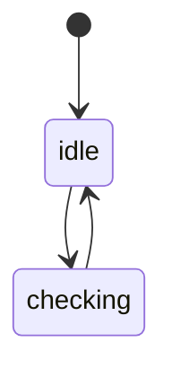

## autonomy.job

Owner: `autonomy.Scheduler.state[job].m` (one per key). One scheduled chore (Sunday Ticket scan, nightly app check...): single-flight, time-boxed.

| State | Meaning | Can move to |
|---|---|---|
| `idle` (initial) | nothing due: between windows, or this window's slot is done | waiting, running |
| `waiting` | inside a window but its safety check (or its group) said not now; re-checks after not_before | running, idle, retrying |
| `running` | a run is in flight (scheduled or 'run now'); nothing else may start it | idle, retrying, waiting |
| `retrying` | the last try failed inside the window; tries again after not_before | running, waiting, idle |

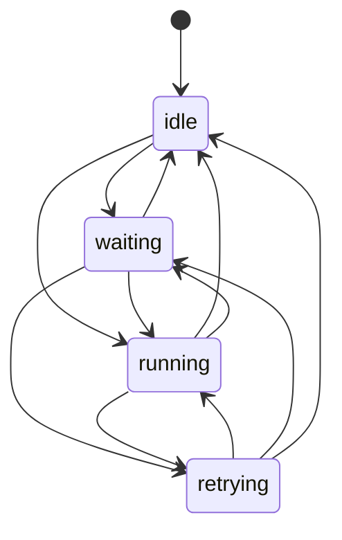

## autonomy.stick_presence

Owner: `autonomy.DeviceHealer.sticks` (one per key). Is a saved stick on the network? Missing 2+ minutes -> the healer looks for its new address.

| State | Meaning | Can move to |
|---|---|---|
| `present` (initial) | connected, or asking for adb approval (that address is right) | missing |
| `missing` | not answering since `since` (offline_since) | present |

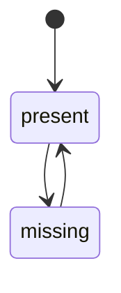

## autonomy.tv_presence

Owner: `autonomy.DeviceHealer.tv`. The Samsung TV as the healer last saw it (power, lost-since and on-LAN move together).

| State | Meaning | Can move to |
|---|---|---|
| `unknown` (initial) | not checked yet, or the Mac is away from home (clocks start fresh) | on, standby, not_answering |
| `on` | the TV's status page answered: on | standby, not_answering, unknown |
| `standby` | the TV's status page answered: standby | on, not_answering, unknown |
| `not_answering` | no answer since `since` (tv_lost_since); tv_on_lan says if its MAC is at the saved address | on, standby, unknown |

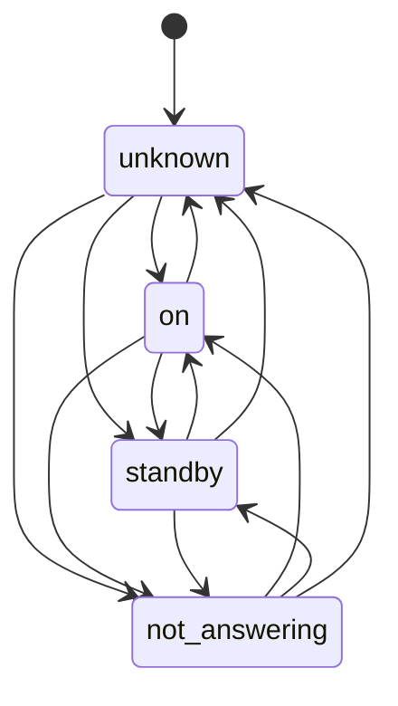

## control.adopt

Owner: `control.Controller.adopt_m`. After a restart the screen may already show a game: adopt it once, never after a rewound picture.

| State | Meaning | Can move to |
|---|---|---|
| `fresh` (initial) | just started: the first switch (or read_screen) may adopt what is on screen | adopted, replayed |
| `adopted` | adopted, or the chance passed: switches tune as usual | replayed |
| `replayed` | a rewound picture was shown since start: never read back as live | - |

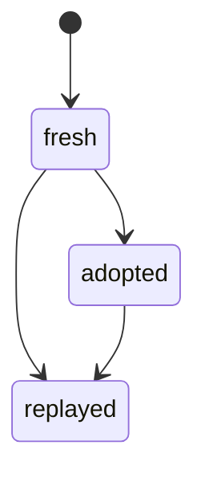

## control.cec

Owner: `control.Controller.cec_m` (one per key). Each stick's HDMI-CEC setting (key = host). Off = it never pauses on input loss; a HOME fallback turns it on for one flip and a restore task turns it off again.

| State | Meaning | Can move to |
|---|---|---|
| `unread` (initial) | not read yet (or unreadable) | on, off, restoring |
| `on` | hdmi_control_enabled=1 | off, restoring, unread |
| `off` | hdmi_control_enabled=0 (scripts/stick_cec.py) | on, restoring, unread |
| `restoring` | turned on for a HOME fallback; a task turns it off again in a few seconds | off, on, unread |

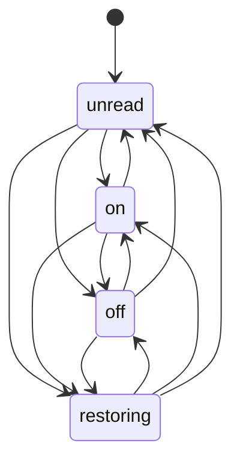

## control.command

Owner: `control.Controller.command_m`. One switch command (submit -> _run -> execute): the newest wins, a flip is never cancelled. The command lock's owner and age are in Controller.view (a stuck lock is visible).

| State | Meaning | Can move to |
|---|---|---|
| `idle` (initial) | no switch command | queued, running |
| `queued` | submitted, waiting for the command lock | running, idle, queued |
| `running` | holds the lock: tuning / scrubbing / parking on the way to the flip | waiting_safe, idle, queued |
| `waiting_safe` | waiting for the safe moment on the visible game (may_cut) | running, idle, queued |

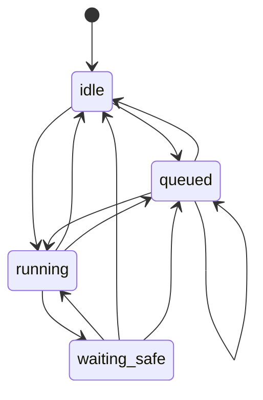

## control.offset

Owner: `control.Controller.offset_m` (one per key). How far behind the live edge a target's stream runs (key = target); `held` keeps the seconds (persisted to data/held.json). A fresh tune puts it back at live.

| State | Meaning | Can move to |
|---|---|---|
| `live` (initial) | at the live edge (held 0) | held, scrubbed, restored |
| `held` | behind live by a pause-hold, a left-game hold, a snap park or a booked stall | live, scrubbed, restored |
| `scrubbed` | behind live by the overlay scrub, read off the time label | live, held, restored |
| `restored` | behind live per data/held.json after a restart: no stick anchor yet, never re-scrubbed just because the anchor is missing | live, held, scrubbed |

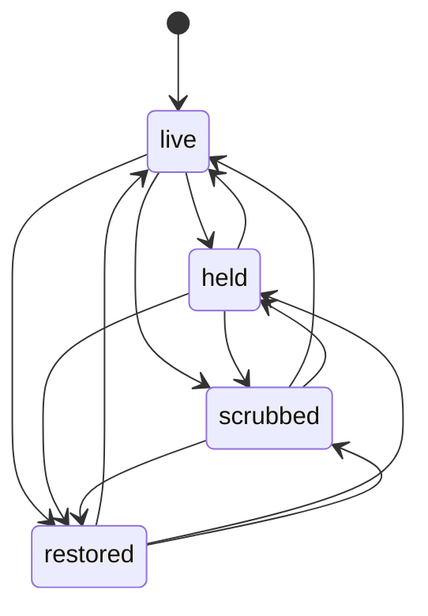

## control.preload_slot

Owner: `control.Controller.slot_m`. The hidden stick's one background job slot (_preload_task): which kind of job owns it. With the switch task and the command lock it is the one answer to 'is a stick busy?' (Controller.stick_job).

| State | Meaning | Can move to |
|---|---|---|
| `idle` (initial) | no background job on the hidden stick | idle, preload, refresh, hold, rescrub, rebuild, reseek, verify |
| `preload` | the planner's (or the phone's) preload: tune, then buffer or park | idle, preload, refresh, hold, rescrub, rebuild, reseek, verify |
| `refresh` | reloading the game we just left at the live edge (any planner preload displaces it) | idle, preload, refresh, hold, rescrub, rebuild, reseek, verify |
| `hold` | buffered jump: pause-hold of a ready standby (_hold_standby) | idle, preload, refresh, hold, rescrub, rebuild, reseek, verify |
| `rescrub` | re-tune + overlay scrub of the standby (buffer_standby / label_stale) | idle, preload, refresh, hold, rescrub, rebuild, reseek, verify |
| `rebuild` | STK-06: rebuilding a lost or drifted hold (_rebuild_buffer) | idle, preload, refresh, hold, rescrub, rebuild, reseek, verify |
| `reseek` | pulling a drifting parked replay back (_reseek) | idle, preload, refresh, hold, rescrub, rebuild, reseek, verify |
| `verify` | pre-game check: tune the target on the hidden stick and report (verify_hidden) | idle, preload, refresh, hold, rescrub, rebuild, reseek, verify |

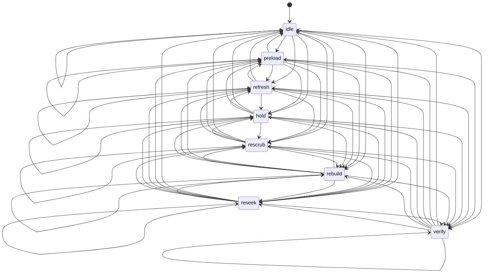

## control.screen

Owner: `control.Controller.screen_m`. Which stick the TV shows and whether we trust it: replaces active/_flipping/input_unknown as loose flags. Every flip start bumps _flip_gen (a read that spans a flip is stale).

| State | Meaning | Can move to |
|---|---|---|
| `known` (initial) | the TV shows sticks[active] (our flip, the TV's readback or CEC agreed) | flipping, resuming, unknown, reasserting, fallback |
| `flipping` | an input change is in progress: not cancellable, no reads trusted | known, resuming, unknown, reasserting, fallback |
| `resuming` | the flip landed; confirming the game plays again on it (still not cancellable) | known, flipping, unknown, reasserting, fallback |
| `unknown` | TV input unknown (unconfirmed flip, someone's remote, CEC lost): no switch until known | known, flipping, reasserting, resuming, fallback |
| `reasserting` | input unknown and a bounded HOME re-assert runs on the stick meant to be on screen | unknown, known, flipping, resuming, fallback |
| `fallback` | the on-screen stick dropped off adb: `main` is the other stick, which the TV is NOT showing, so the visible watchdog/restore don't touch it until the stick is back | known, unknown, flipping, resuming, reasserting |

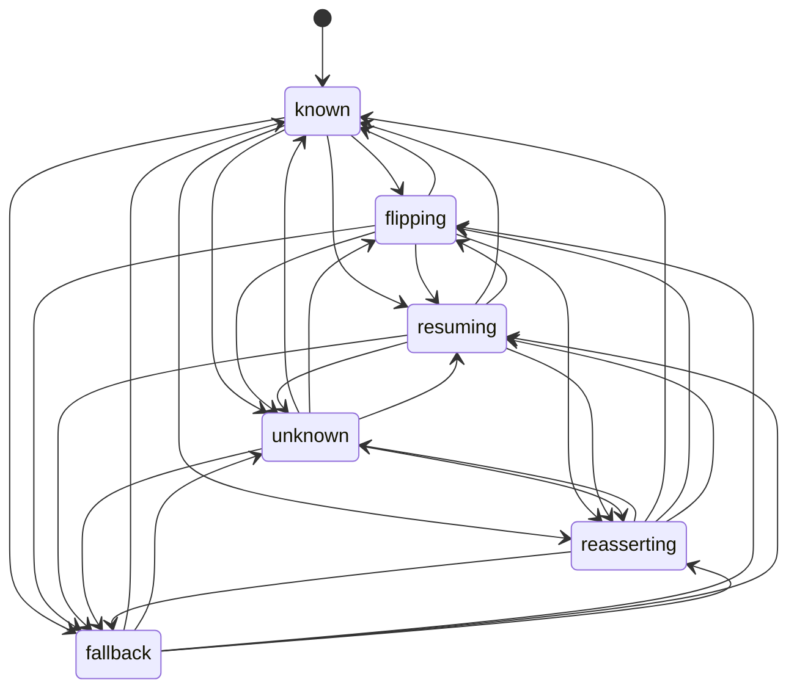

## control.standby

Owner: `control.Controller.standby_m`. What the hidden stick holds for the next flip: one state replaces hidden_target/hidden_ready/parked/_snap_park/_holding/_left/_stuck_since, so 'ready while holding' or 'left hold and parked' can't happen.

| State | Meaning | Can move to |
|---|---|---|
| `empty` (initial) | holds nothing we know of (start, after a drop, a failed or cancelled tune) | loading, scrubbing, ready, replay_parked, holding |
| `loading` | a target is being tuned, rebuilt or is unconfirmed: never flipped to | empty, scrubbing, holding, stuck, ready, replay_parked, left_hold |
| `scrubbing` | a fresh tune is being scrubbed behind live by the overlay (yttv_seek): never flipped to | empty, loading, ready, holding |
| `holding` | a pause-hold is running (time-shift buffer): resumes behind live, not flippable meanwhile | empty, loading, scrubbing, ready |
| `stuck` | not ready with nothing running on it (buffered jump drops it after stuck_s) | empty, loading, scrubbing, holding, ready |
| `ready` | playing the target, confirmed: a flip shows it (live, or behind live per control.offset) | empty, loading, scrubbing, holding, snap_parked, replay_parked, left_hold |
| `snap_parked` | ready and paused on the line-up before its next snap: PLAY rolls it at the flip | empty, loading, scrubbing, ready, replay_parked |
| `replay_parked` | rewound to a replay and held still: old footage, never used for a live switch | empty, loading, scrubbing, ready |
| `left_hold` | the game we just left, paused at the dead ball we left it on (STK-07) | empty, loading, scrubbing, ready, replay_parked |

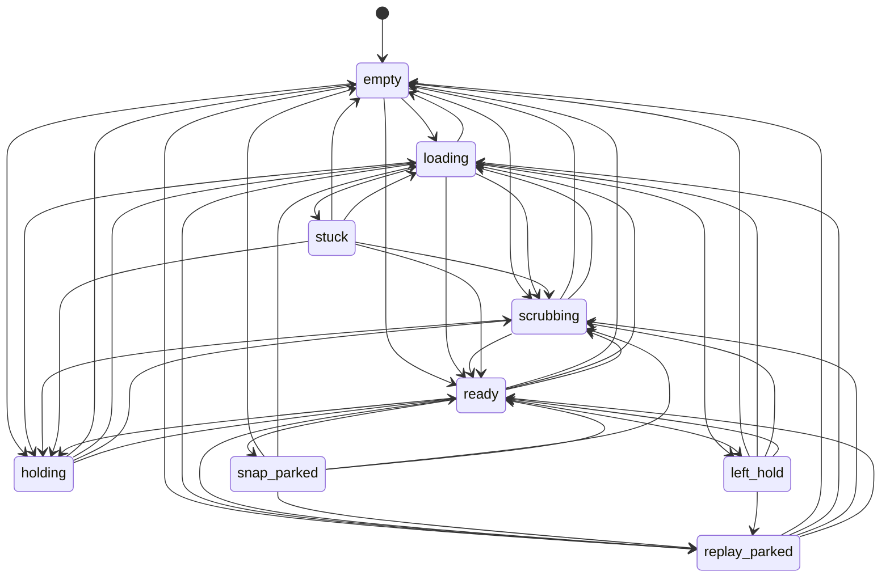

## control.two_stick

Owner: `control.Controller.two_stick_m`. Two-stick (hot standby) mode health: a failed flip degrades to single-stick (hidden is None) until TWO_STICK_RETRY_S has passed and the input is known again. Config/stick-count reasons are in view.

| State | Meaning | Can move to |
|---|---|---|
| `on` (initial) | two-stick mode allowed (still needs config, 2 usable sticks, a flip path and HDMI inputs) | degraded |
| `degraded` | an input flip failed: single-stick until the retry time and a known input | on |

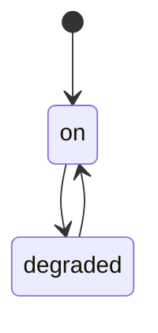

## control.visible

Owner: `control.Controller.visible_m`. The stick on screen should be playing what we put there: replaces _visible_bad_since/_visible_state as loose fields (the 'how' resets when healthy).

| State | Meaning | Can move to |
|---|---|---|
| `ok` (initial) | playing (or nothing to watch) | bad, repairing, restoring |
| `bad` | seen not playing (paused / frozen / stopped / none); re-checked before any repair | ok, repairing, restoring |
| `repairing` | the resume ladder runs (MEDIA_PLAY, prompt, re-link) on the stick on screen | ok, bad, restoring |
| `restoring` | the supervisor's restore_visible runs (relink or resume) | ok, bad, repairing |

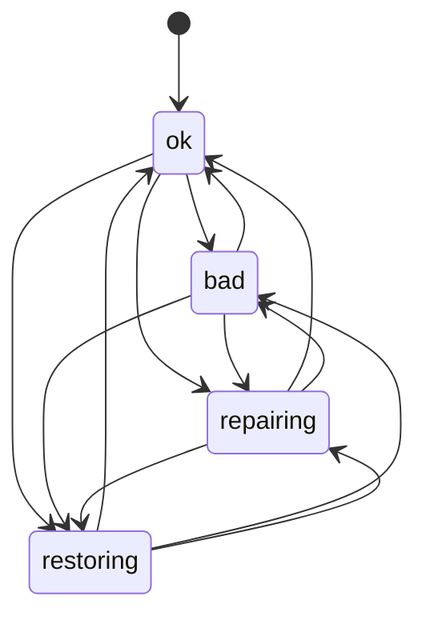

## decider.delay_label

Owner: `decider.screen.DelayBook.label_m` (one per key). [edge model] per target: is YouTube TV's overlay time label this tune's behind-live figure?

| State | Meaning | Can move to |
|---|---|---|
| `none` (initial) | no label read for this tune (a fresh tune lands on the live edge) | read |
| `read` | a label read for the tune now on this target sets its behind_live | none, stale, read |
| `stale` | the stream stalled after the read: behind +3 s, doubt +5 s until it's read again | none, read, stale |

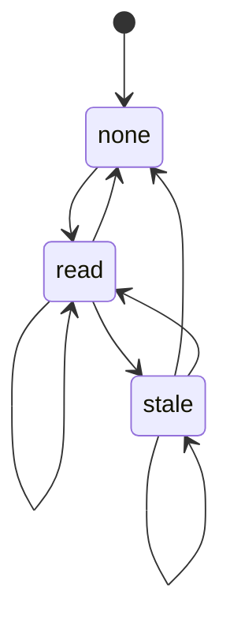

## decider.entry_wait

Owner: `decider.Decider.entry_m`. [cut timing] a switch waiting for a dead ball to land on (bounded by decider.entry.max_wait_s.<league>)

| State | Meaning | Can move to |
|---|---|---|
| `idle` (initial) | no switch waiting for a landing | waiting |
| `waiting` | waiting on a dead ball in the key's game (since = first wait) | idle, waiting |

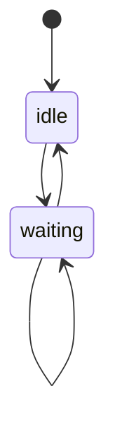

## decider.home

Owner: `decider.Decider.home_m`. A break visit: the game we left only for its break (home_break_visit) and when to head back

| State | Meaning | Can move to |
|---|---|---|
| `none` (initial) | no visit: we're home, or nothing to go back to | visit, visit_timed |
| `visit` | visiting during home's break; back at its next due moment | none, visit_timed, visit |
| `visit_timed` | a long-break visit with a latest return time (home_return_at) | none, visit, visit_timed |

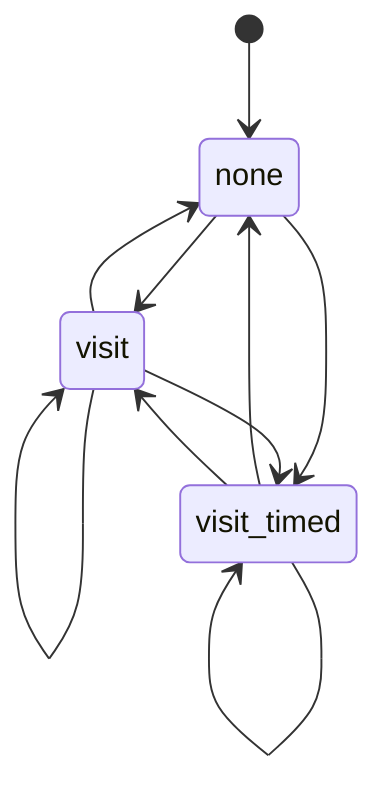

## decider.jump_break

Owner: `decider.Decider.jump_break_m` (one per key). [jump mode] per game: since when the feed has said 'break' (the break counts as on screen a delay later)

| State | Meaning | Can move to |
|---|---|---|
| `play` (initial) | the feed doesn't say break | break |
| `break` | the feed says break since `since` | play |

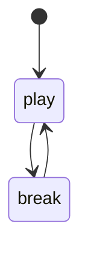

## decider.leave_wait

Owner: `decider.Decider.leave_m`. [legal.leave_at_flip] the arbiter's cut, remembered until the flip's leave rules and a dead-ball landing both allow it

| State | Meaning | Can move to |
|---|---|---|
| `idle` (initial) | no cut is waiting | waiting |
| `waiting` | the cut to the key's game goes when leave and landing allow it, or expires (too long, can't be entered, not worth it) | idle |

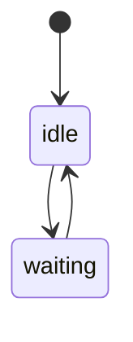

## decider.lock_wait

Owner: `decider.Decider.lock_m`. [lock wait] your locked game can't be reached: wait with a reason and a retry, then give the lock up

| State | Meaning | Can move to |
|---|---|---|
| `idle` (initial) | the locked game is reachable (or nothing is locked) | waiting |
| `waiting` | can't reach it (no channel / a failed tune) since lock_since; retries at lock_retry_at | idle, expired |
| `expired` | gave up after decider.lock_wait.max_s: the engine releases the lock | idle, waiting |

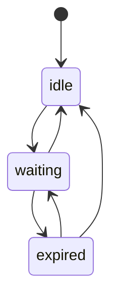

## decider.override

Owner: `decider.Decider.override_m`. Your strongest override this tick, in the order the decider honours them (a view of UserState + safe mode)

| State | Meaning | Can move to |
|---|---|---|
| `auto` (initial) | autopilot | any |
| `focus` | focus mode on a game: leave only at its breaks (or for something huge) | any |
| `manual` | you just picked a game: hands off for decider.manual_pause_s | any |
| `locked` | you locked / held a game ('Watch this') | any |
| `paused` | you paused auto-switching | any |
| `safe` | safe mode | any |

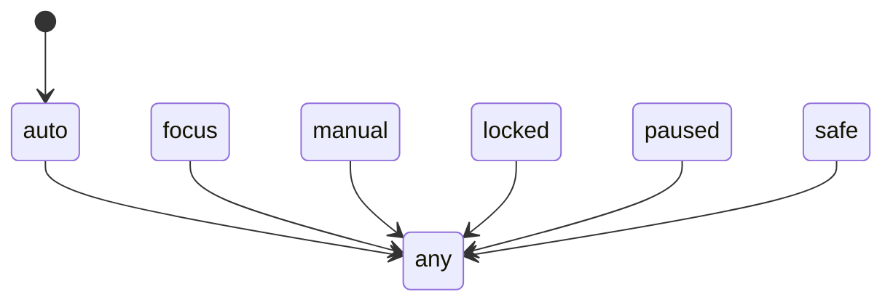

## decider.owner

Owner: `decider.Decider.owner_m`. Which decider owns the TV this tick: set once per decide(), the others' gates read it

| State | Meaning | Can move to |
|---|---|---|
| `idle` (initial) | no tick yet | any |
| `safe` | safe mode: repeated errors, nothing switches until Resume (or the timed auto-resume) | any |
| `user` | your override: paused, a locked / held game, focus mode, or hands-off after a tap | any |
| `replay` | a catch-up replay is on screen or just ended: the replay lifecycle picks the way back to live | any |
| `hard` | jump mode on, but the normal decider's must-go switch (crunch, ended, your tap, a chase...) goes | any |
| `normal` | the normal decider (jump mode off, or the screen's game isn't in the rotation) | any |
| `jump` | jump mode's rotation: it decides every optional switch; the normal decider's become stays | any |
| `buffered` | buffered jump (both sticks behind live): the editor decides, incl. the screen-gone free cut | any |

```mermaid
stateDiagram-v2
    [*] --> idle
    idle --> any
    safe --> any
    user --> any
    replay --> any
    hard --> any
    normal --> any
    jump --> any
    buffered --> any
```

## decider.safe

Owner: `decider.Decider.safe_m`. Safe mode: three errors in five minutes hold the TV still until Resume (or the timed auto-resume)

| State | Meaning | Can move to |
|---|---|---|
| `ok` (initial) | switching normally | safe |
| `safe` | holding still after repeated errors (since = safe_since) | ok |

```mermaid
stateDiagram-v2
    [*] --> ok
    ok --> safe
    safe --> ok
```

## decider.screen

Owner: `decider.Decider.screen_m`. What the TV picture is: nothing known, a tune landing, a live game, a replay, or old replay footage

| State | Meaning | Can move to |
|---|---|---|
| `unknown` (initial) | no game confirmed on screen (start, restart, dry run turned off) | tuning, live, replaying |
| `tuning` | a switch was committed; the picture is black until the tune's estimated arrival | live, tuning, replaying, after_replay, unknown |
| `live` | a live game is on screen (decider.current) | tuning, replaying, unknown |
| `replaying` | a catch-up replay clip is playing (decider.replaying) | after_replay, unknown |
| `after_replay` | the clip ended or was cut short: the picture is old footage until a live tune | tuning, live, replaying, unknown |

```mermaid
stateDiagram-v2
    [*] --> unknown
    unknown --> tuning
    unknown --> live
    unknown --> replaying
    tuning --> live
    tuning --> tuning
    tuning --> replaying
    tuning --> after_replay
    tuning --> unknown
    live --> tuning
    live --> replaying
    live --> unknown
    replaying --> after_replay
    replaying --> unknown
    after_replay --> tuning
    after_replay --> live
    after_replay --> replaying
    after_replay --> unknown
```

## decider.screen_gone

Owner: `decider.Decider.gone_m`. [buffered jump] the screen's game is unknown/gone and a buffered standby is held from a start/ended switch

| State | Meaning | Can move to |
|---|---|---|
| `present` (initial) | nothing held (the screen's game is known, or there's no buffered standby to keep) | keeping |
| `keeping` | holding the buffered standby for buffered_jump.keep_standby_s (since = window start) | let_go, present |
| `let_go` | the keep window ran out: the normal start/ended switch goes | present |

```mermaid
stateDiagram-v2
    [*] --> present
    present --> keeping
    keeping --> let_go
    keeping --> present
    let_go --> present
```

## decider.start

Owner: `decider.Decider.start_m`. The first pick after a (re)start: free to pick, or backing off after picks that didn't land

| State | Meaning | Can move to |
|---|---|---|
| `ready` (initial) | no failed start pending: the next start pick may go | backoff |
| `backoff` | a start pick didn't land: the next waits until start_retry_at (3 s doubling, max 60 s) | ready, backoff |

```mermaid
stateDiagram-v2
    [*] --> ready
    ready --> backoff
    backoff --> ready
    backoff --> backoff
```

## discovery.device_work

Owner: `discovery.runtime.DiscoveryRuntime.device_work`. Background device maintenance (stick package reads, autonomy jobs). A recorded session suspends it; recorded.active also counts as suspended while set.

| State | Meaning | Can move to |
|---|---|---|
| `running` (initial) | device work may run on its 15 s loop (still gated by autonomy.enabled, dry run) | suspended |
| `suspended` | a recorded session drained it; nothing touches a device until resume | running |

```mermaid
stateDiagram-v2
    [*] --> running
    running --> suspended
    suspended --> running
```

## engine.fail_cool

Owner: `engine.Engine._fail_cool` (one per key). Per tuner target: a failed switch isn't retried before its cool-down ends (decider.fail_cooldown_s)

| State | Meaning | Can move to |
|---|---|---|
| `ok` (initial) | may be tuned | cooling |
| `cooling` | failed a moment ago: not a candidate target until `until` | ok, cooling |

```mermaid
stateDiagram-v2
    [*] --> ok
    ok --> cooling
    cooling --> ok
    cooling --> cooling
```

## engine.focus_suspend

Owner: `engine.Engine.focus_m`. Your focus game went garbage time: focus is suspended (roaming) until it's close again

| State | Meaning | Can move to |
|---|---|---|
| `none` (initial) | focus as you set it | suspended |
| `suspended` | focus paused for garbage time; restored when it's close | none |

```mermaid
stateDiagram-v2
    [*] --> none
    none --> suspended
    suspended --> none
```

## engine.hold

Owner: `engine.Engine.hold_m`. 'Watch this' / lock from the phone: one fact (engine.hold mirrors decider.user.locked_game)

| State | Meaning | Can move to |
|---|---|---|
| `none` (initial) | no hold | held |
| `held` | staying on the held game until Resume auto | none, resuming, held |
| `resuming` | the held game ended or went garbage: autopilot takes over at resume_at | held, none |

```mermaid
stateDiagram-v2
    [*] --> none
    none --> held
    held --> none
    held --> resuming
    held --> held
    resuming --> held
    resuming --> none
```

## engine.pending

Owner: `engine.Engine.pending_m`. The one switch in flight: submitted to the controller until its done() resolves it (or it's superseded)

| State | Meaning | Can move to |
|---|---|---|
| `idle` (initial) | no switch in flight | pending |
| `pending` | a switch / replay was submitted; decisions wait for its outcome | idle, pending |

```mermaid
stateDiagram-v2
    [*] --> idle
    idle --> pending
    pending --> idle
    pending --> pending
```

## engine.skip

Owner: `engine.Engine.skip_m` (one per key). A skipped game: muted for SKIP_S from when the TV leaves it, then unmuted

| State | Meaning | Can move to |
|---|---|---|
| `none` (initial) | not skipped | leaving, muted |
| `leaving` | skipped while on screen: waiting for a dead ball to leave (the clock restarts each tick) | muted, none |
| `muted` | left it: muted until the skip expires | leaving, none |

```mermaid
stateDiagram-v2
    [*] --> none
    none --> leaving
    none --> muted
    leaving --> muted
    leaving --> none
    muted --> leaving
    muted --> none
```

## engine.standby_plan

Owner: `engine.Engine.standby_m`. Who decided what the hidden stick holds this tick (one owner per tick)

| State | Meaning | Can move to |
|---|---|---|
| `idle` (initial) | nothing planned (one stick, paused, or a switch in flight) | any |
| `peek` | a game you opened on the phone holds the hidden stick | any |
| `rotation` | jump mode's rotation picks the hidden stick's next game | any |
| `buffered` | buffered jump: the rotation picks the game, the park step scrubs / parks it | any |
| `planner` | the standby planner (redzone/standby.py): break returns, replays, the likely next switch | any |
| `queue` | the game queue (redzone/noggin/gamequeue.py, queue.enabled) chose it | any |

```mermaid
stateDiagram-v2
    [*] --> idle
    idle --> any
    peek --> any
    rotation --> any
    buffered --> any
    planner --> any
    queue --> any
```

## governor.level

Owner: `governor.Governor.m`. How much optional work the Mac can take (reels, lab, archive, OCR, local model). Up at once, down only after calm_s.

| State | Meaning | Can move to |
|---|---|---|
| `normal` (initial) | everything runs | eco, critical |
| `eco` | battery/busy/hot/memory/disk: no reels, lab or archive; OCR and idle polls slower | normal, critical |
| `critical` | as eco, plus no score-bug OCR and no local model | normal, eco |

```mermaid
stateDiagram-v2
    [*] --> normal
    normal --> eco
    normal --> critical
    eco --> normal
    eco --> critical
    critical --> normal
    critical --> eco
```

## recorded.session

Owner: `recorded.RecordedPlayback.session`. A recorded-game session on one stick. While it is anything but idle, live switching, the supervisor and background device work stay off.

| State | Meaning | Can move to |
|---|---|---|
| `idle` (initial) | no recorded session | preparing |
| `preparing` | start() accepted: live work cancelled and drained, device jobs suspended | navigating, failed, idle |
| `navigating` | the navigation task is driving the selected stick | finished, failed, idle |
| `finished` | navigation ended (playback requested or nothing found); waiting for Stop | idle |
| `failed` | preparation or navigation stopped early (error, timeout, cancelled); waiting for Stop | idle |

```mermaid
stateDiagram-v2
    [*] --> idle
    idle --> preparing
    preparing --> navigating
    preparing --> failed
    preparing --> idle
    navigating --> finished
    navigating --> failed
    navigating --> idle
    finished --> idle
    failed --> idle
```

## deploy.lifecycle

Owner: `scripts.deploy.Deployer.m`. The safe-deploy lifecycle, persisted in data/deploy/state.json ('machine'). The deploy gate, the watchdog marker and `deploy.py status` all read this one state.

| State | Meaning | Can move to |
|---|---|---|
| `idle` (initial) | no deploy running (initial; also after tests failed, a dry run or 'already current') | testing, waiting_idle, rolling_back, deployed |
| `testing` | the suite runs on the new commit in data/deploy/stage; nothing changed yet | idle, waiting_idle |
| `waiting_idle` | tests passed; waiting for no live game (live_wait_s) | deferred, switching, idle |
| `deferred` | a game was live: nothing changed; try again after the games | testing, waiting_idle, rolling_back, idle, deployed |
| `switching` | config/models saved, checking out the new commit and restarting (marker on) | watching, rolling_back, interrupted |
| `watching` | health watch of the new version against the old one (marker on) | deployed, rolling_back, interrupted |
| `deployed` | healthy: HEAD recorded as good | testing, waiting_idle, rolling_back, idle |
| `rolling_back` | worse (or asked by hand): putting the last good code + config/models back | rolled_back, rollback_failed, interrupted |
| `rolled_back` | the rollback came up | testing, waiting_idle, rolling_back, idle, deployed |
| `rollback_failed` | the rollback did not come up: deploys refuse; confirm needs --force | rolling_back, deployed |
| `interrupted` | a switch/watch never finished (process died, Mac slept): deploys refuse until rollback or confirm | rolling_back, deployed |

```mermaid
stateDiagram-v2
    [*] --> idle
    idle --> testing
    idle --> waiting_idle
    idle --> rolling_back
    idle --> deployed
    testing --> idle
    testing --> waiting_idle
    waiting_idle --> deferred
    waiting_idle --> switching
    waiting_idle --> idle
    deferred --> testing
    deferred --> waiting_idle
    deferred --> rolling_back
    deferred --> idle
    deferred --> deployed
    switching --> watching
    switching --> rolling_back
    switching --> interrupted
    watching --> deployed
    watching --> rolling_back
    watching --> interrupted
    deployed --> testing
    deployed --> waiting_idle
    deployed --> rolling_back
    deployed --> idle
    rolling_back --> rolled_back
    rolling_back --> rollback_failed
    rolling_back --> interrupted
    rolled_back --> testing
    rolled_back --> waiting_idle
    rolled_back --> rolling_back
    rolled_back --> idle
    rolled_back --> deployed
    rollback_failed --> rolling_back
    rollback_failed --> deployed
    interrupted --> rolling_back
    interrupted --> deployed
```

## fastcast.connection

Owner: `sources.fastcast.FastcastClient.conn`. The one ESPN Fastcast websocket.

| State | Meaning | Can move to |
|---|---|---|
| `idle` (initial) | nothing wanted (no live games): no socket, no reconnect warnings | connecting, stopped |
| `connecting` | looking up the host and opening the socket | connected, backing_off, idle, stopped |
| `connected` | session started (ESPN said C); topics subscribe over it | idle, backing_off, connecting, stopped |
| `backing_off` | the last session failed; waiting backoff_s(failures) before reconnecting | connecting, idle, stopped |
| `stopped` | stop() was called: run() returns and never reconnects | - |

```mermaid
stateDiagram-v2
    [*] --> idle
    idle --> connecting
    idle --> stopped
    connecting --> connected
    connecting --> backing_off
    connecting --> idle
    connecting --> stopped
    connected --> idle
    connected --> backing_off
    connected --> connecting
    connected --> stopped
    backing_off --> connecting
    backing_off --> idle
    backing_off --> stopped
```

## fastcast.topic

Owner: `sources.fastcast._Sub.m` (one per key). One subscribed Fastcast topic (one game). Only `live` with a usable document reaches the merger.

| State | Meaning | Can move to |
|---|---|---|
| `subscribing` (initial) | S sent; waiting for ESPN's answer | subscribed, loading, live, dropped |
| `subscribed` | ESPN accepted; waiting for the H checkpoint pointer | loading, live, dropped |
| `loading` | downloading a checkpoint; updates meanwhile wait in TopicDoc.pending | live, dropped |
| `live` | checkpoint installed; patches apply in mid order | loading, dropped |
| `dropped` | unsubscribed or dropped for a retry (client._retry says when) | - |

```mermaid
stateDiagram-v2
    [*] --> subscribing
    subscribing --> subscribed
    subscribing --> loading
    subscribing --> live
    subscribing --> dropped
    subscribed --> loading
    subscribed --> live
    subscribed --> dropped
    loading --> live
    loading --> dropped
    live --> loading
    live --> dropped
```

## merge.feed

Owner: `sources.merge.Merger.feeds` (one per key). One source's copy of one game (key 'source|game'): trusted, or benched after backward jumps.

| State | Meaning | Can move to |
|---|---|---|
| `trusted` (initial) | its updates may lead the merged game | regressing, benched |
| `regressing` | jumped backwards inside REGRESSION_WINDOW_S, fewer than UNHEALTHY_REGRESSIONS times | trusted, benched |
| `benched` | UNHEALTHY_REGRESSIONS backward jumps: ignored for this game for BENCH_S, then re-baselined | trusted |

```mermaid
stateDiagram-v2
    [*] --> trusted
    trusted --> regressing
    trusted --> benched
    regressing --> trusted
    regressing --> benched
    benched --> trusted
```

## supervisor.app

Owner: `supervisor.Supervisor.apps` (one per key). One streaming app (youtubetv, prime, espn...). A muted app mutes every one of its targets, including ones that show up later in the night. Memory only.

| State | Meaning | Can move to |
|---|---|---|
| `available` (initial) | the app's targets are judged one by one | muted_night |
| `muted_night` | app_mute_targets of its targets muted (or app_mute_failures source failures): every target of this app is skipped until the night ends | available |

```mermaid
stateDiagram-v2
    [*] --> available
    available --> muted_night
    muted_night --> available
```

## supervisor.condition

Owner: `supervisor.Supervisor.conditions` (one per key). A watched condition (idle_with_live, stale_feeds, adb:<host>, delay_doubt:<target>...): how long it has held without a break. A rule acts only once it has held long enough.

| State | Meaning | Can move to |
|---|---|---|
| `clear` (initial) | the condition is false (or a fix just re-armed its clock) | held |
| `held` | the condition has been true since `since` | clear |

```mermaid
stateDiagram-v2
    [*] --> clear
    clear --> held
    held --> clear
```

## supervisor.loop

Owner: `supervisor.Supervisor.loop`. Is the supervisor's background loop running, and is it acting on its rules right now?

| State | Meaning | Can move to |
|---|---|---|
| `stopped` (initial) | run() isn't running (not started yet, or it ended/was cancelled) | running |
| `running` | loop alive; every rule runs each step | disabled, yielded, stopped |
| `disabled` | loop alive but supervisor.enabled is off: steps do nothing | running, yielded, stopped |
| `yielded` | loop alive but a recorded session drives the screen: steps do nothing | running, disabled, stopped |

```mermaid
stateDiagram-v2
    [*] --> stopped
    stopped --> running
    running --> disabled
    running --> yielded
    running --> stopped
    disabled --> running
    disabled --> yielded
    disabled --> stopped
    yielded --> running
    yielded --> disabled
    yielded --> stopped
```

## supervisor.safe_episode

Owner: `supervisor.Supervisor.safe_episode`. The decider's safe mode as recorded episodes for the report and error budget (an edge detector over decider.safe_mode; the decider owns safe mode itself).

| State | Meaning | Can move to |
|---|---|---|
| `unknown` (initial) | not looked yet this run (a first look at 'off' records nothing) | off, on |
| `off` | last recorded: safe mode off | on |
| `on` | last recorded: safe mode on (an 'episode on' row was written) | off |

```mermaid
stateDiagram-v2
    [*] --> unknown
    unknown --> off
    unknown --> on
    off --> on
    on --> off
```

## supervisor.screen_check

Owner: `supervisor.Supervisor.screen`. The screen_not_game two-look confirm: the TV must look wrong on two checks screen_confirm_s apart before the supervisor touches the visible stick.

| State | Meaning | Can move to |
|---|---|---|
| `clear` (initial) | nothing wrong seen (or blocked: dry run, switch in flight, replay, watchdog acting...) | suspect |
| `suspect` | home screen / app page seen once for this target; waiting to look again | clear, restoring |
| `restoring` | confirmed twice: restore_visible is running on the stick on screen | clear, suspect |

```mermaid
stateDiagram-v2
    [*] --> clear
    clear --> suspect
    suspect --> clear
    suspect --> restoring
    restoring --> clear
    restoring --> suspect
```

## supervisor.target

Owner: `supervisor.Supervisor.targets` (one per key). One way to watch (app:channel) as the repeat_failures rule sees it. Memory only: a restart forgets back-offs and night mutes (the engine's own cool-downs still apply).

| State | Meaning | Can move to |
|---|---|---|
| `available` (initial) | no supervisor penalty; may be tuned | backed_off, muted_night |
| `backed_off` | failed backoff_after+ times in fail_window_s: engine cool-down pushed out backoff_s | available, muted_night |
| `muted_night` | source failures reached mute_after (or it caused a stuck safe mode): skipped until the night ends (6 AM ET) | available |

```mermaid
stateDiagram-v2
    [*] --> available
    available --> backed_off
    available --> muted_night
    backed_off --> available
    backed_off --> muted_night
    muted_night --> available
```

## tuners.adb_shell

Owner: `tuners.adb.AdbShell.m`. The always-open `adb shell` to one stick. Broken = one adb process per command until retry_at.

| State | Meaning | Can move to |
|---|---|---|
| `closed` (initial) | no shell process (not opened yet, killed after a hang or a lost reply) | opening, broken |
| `opening` | starting the process and its handshake | ready, closed, broken |
| `ready` | open and answering | closed, opening |
| `broken` | failed to start/handshake: backing off (5 s doubling to 300 s) until retry_at | opening, closed |

```mermaid
stateDiagram-v2
    [*] --> closed
    closed --> opening
    closed --> broken
    opening --> ready
    opening --> closed
    opening --> broken
    ready --> closed
    ready --> opening
    broken --> opening
    broken --> closed
```

## tuners.prime_tune

Owner: `tuners.tuners.PrimeTuner.tune_m` (one per key). One Prime deep-link tune per stick (key = host): what the confirm loop has seen since the link.

| State | Meaning | Can move to |
|---|---|---|
| `idle` (initial) | no Prime tune yet on this stick | linked |
| `linked` | deep link sent; waiting for a new player screen | page, pressed |
| `page` | the detail page (or its Watch Live panel) was seen | pressed, linked |
| `pressed` | we pressed Watch / Watch Live on the page | linked |

```mermaid
stateDiagram-v2
    [*] --> idle
    idle --> linked
    linked --> page
    linked --> pressed
    page --> pressed
    page --> linked
    pressed --> linked
```

## tuners.stick_link

Owner: `tuners.adb.Stick.link_m`. One Fire TV stick's adb connection (Stick.state). A failed connect waits _next_retry (one keepalive).

| State | Meaning | Can move to |
|---|---|---|
| `unknown` (initial) | not tried yet | connected, offline, unauthorized |
| `connected` | adb connect + a shell probe answered | offline, unauthorized, unknown |
| `offline` | unreachable, or adb says device offline | connected, unauthorized, unknown |
| `unauthorized` | adb is not authorized on the stick (accept the prompt on the TV) | connected, offline, unknown |

```mermaid
stateDiagram-v2
    [*] --> unknown
    unknown --> connected
    unknown --> offline
    unknown --> unauthorized
    connected --> offline
    connected --> unauthorized
    connected --> unknown
    offline --> connected
    offline --> unauthorized
    offline --> unknown
    unauthorized --> connected
    unauthorized --> offline
    unauthorized --> unknown
```

## tuners.yttv_search

Owner: `tuners.yttv_search.YTTVSearchProof.stage_m`. How far a recorded-game navigation (recorded.py + yttv_search) got: stages only move forward.

| State | Meaning | Can move to |
|---|---|---|
| `none` (initial) | nothing done yet | preparing_local_ocr, local_ocr_ready, checking_selected_connection, selected_connection_verified, search_opened, team_catalog_opened, matching_caption_observed, recording_selection_sent, dated_watch_selected, replay_start_sent, player_identity_observed, player_title_observed |
| `preparing_local_ocr` | recorded.py: preparing the local screen reader | local_ocr_ready, checking_selected_connection, selected_connection_verified, search_opened, team_catalog_opened, matching_caption_observed, recording_selection_sent, dated_watch_selected, replay_start_sent, player_identity_observed, player_title_observed |
| `local_ocr_ready` | recorded.py: the screen reader is ready | checking_selected_connection, selected_connection_verified, search_opened, team_catalog_opened, matching_caption_observed, recording_selection_sent, dated_watch_selected, replay_start_sent, player_identity_observed, player_title_observed |
| `checking_selected_connection` | recorded.py: checking the selected stick only | selected_connection_verified, search_opened, team_catalog_opened, matching_caption_observed, recording_selection_sent, dated_watch_selected, replay_start_sent, player_identity_observed, player_title_observed |
| `selected_connection_verified` | recorded.py: the selected stick answered as the saved model | search_opened, team_catalog_opened, matching_caption_observed, recording_selection_sent, dated_watch_selected, replay_start_sent, player_identity_observed, player_title_observed |
| `search_opened` | YouTube TV search opened | team_catalog_opened, matching_caption_observed, recording_selection_sent, dated_watch_selected, replay_start_sent, player_identity_observed, player_title_observed |
| `team_catalog_opened` | the team's catalog page opened | matching_caption_observed, recording_selection_sent, dated_watch_selected, replay_start_sent, player_identity_observed, player_title_observed |
| `matching_caption_observed` | a caption matching the requested game was read | recording_selection_sent, dated_watch_selected, replay_start_sent, player_identity_observed, player_title_observed |
| `recording_selection_sent` | the recording was selected | dated_watch_selected, replay_start_sent, player_identity_observed, player_title_observed |
| `dated_watch_selected` | the dated Watch entry was selected | replay_start_sent, player_identity_observed, player_title_observed |
| `replay_start_sent` | start-from-beginning was sent | player_identity_observed, player_title_observed |
| `player_identity_observed` | the player shows the requested game | player_title_observed |
| `player_title_observed` | the player title was read (proof complete) | - |

```mermaid
stateDiagram-v2
    [*] --> none
    none --> preparing_local_ocr
    none --> local_ocr_ready
    none --> checking_selected_connection
    none --> selected_connection_verified
    none --> search_opened
    none --> team_catalog_opened
    none --> matching_caption_observed
    none --> recording_selection_sent
    none --> dated_watch_selected
    none --> replay_start_sent
    none --> player_identity_observed
    none --> player_title_observed
    preparing_local_ocr --> local_ocr_ready
    preparing_local_ocr --> checking_selected_connection
    preparing_local_ocr --> selected_connection_verified
    preparing_local_ocr --> search_opened
    preparing_local_ocr --> team_catalog_opened
    preparing_local_ocr --> matching_caption_observed
    preparing_local_ocr --> recording_selection_sent
    preparing_local_ocr --> dated_watch_selected
    preparing_local_ocr --> replay_start_sent
    preparing_local_ocr --> player_identity_observed
    preparing_local_ocr --> player_title_observed
    local_ocr_ready --> checking_selected_connection
    local_ocr_ready --> selected_connection_verified
    local_ocr_ready --> search_opened
    local_ocr_ready --> team_catalog_opened
    local_ocr_ready --> matching_caption_observed
    local_ocr_ready --> recording_selection_sent
    local_ocr_ready --> dated_watch_selected
    local_ocr_ready --> replay_start_sent
    local_ocr_ready --> player_identity_observed
    local_ocr_ready --> player_title_observed
    checking_selected_connection --> selected_connection_verified
    checking_selected_connection --> search_opened
    checking_selected_connection --> team_catalog_opened
    checking_selected_connection --> matching_caption_observed
    checking_selected_connection --> recording_selection_sent
    checking_selected_connection --> dated_watch_selected
    checking_selected_connection --> replay_start_sent
    checking_selected_connection --> player_identity_observed
    checking_selected_connection --> player_title_observed
    selected_connection_verified --> search_opened
    selected_connection_verified --> team_catalog_opened
    selected_connection_verified --> matching_caption_observed
    selected_connection_verified --> recording_selection_sent
    selected_connection_verified --> dated_watch_selected
    selected_connection_verified --> replay_start_sent
    selected_connection_verified --> player_identity_observed
    selected_connection_verified --> player_title_observed
    search_opened --> team_catalog_opened
    search_opened --> matching_caption_observed
    search_opened --> recording_selection_sent
    search_opened --> dated_watch_selected
    search_opened --> replay_start_sent
    search_opened --> player_identity_observed
    search_opened --> player_title_observed
    team_catalog_opened --> matching_caption_observed
    team_catalog_opened --> recording_selection_sent
    team_catalog_opened --> dated_watch_selected
    team_catalog_opened --> replay_start_sent
    team_catalog_opened --> player_identity_observed
    team_catalog_opened --> player_title_observed
    matching_caption_observed --> recording_selection_sent
    matching_caption_observed --> dated_watch_selected
    matching_caption_observed --> replay_start_sent
    matching_caption_observed --> player_identity_observed
    matching_caption_observed --> player_title_observed
    recording_selection_sent --> dated_watch_selected
    recording_selection_sent --> replay_start_sent
    recording_selection_sent --> player_identity_observed
    recording_selection_sent --> player_title_observed
    dated_watch_selected --> replay_start_sent
    dated_watch_selected --> player_identity_observed
    dated_watch_selected --> player_title_observed
    replay_start_sent --> player_identity_observed
    replay_start_sent --> player_title_observed
    player_identity_observed --> player_title_observed
```

## tv.smartthings

Owner: `tv.SamsungTV.st_m`. SmartThings cloud fault (hardening.smartthings): replaces st_fault/_auth_failed. The breaker (st_breaker) paces cloud_down and rate_limited; auth is blocked until the OAuth file changes or an hour.

| State | Meaning | Can move to |
|---|---|---|
| `ok` (initial) | no fault | auth, rate_limited, cloud_down |
| `auth` | sign-in refused: cloud blocked until tv_setup.py rewrites the OAuth file or AUTH_RETRY_S passes | auth_retry, ok, rate_limited, cloud_down |
| `auth_retry` | an auth fault whose block expired: the next call (or the keepalive probe) tries once more | ok, auth, rate_limited, cloud_down |
| `rate_limited` | HTTP 429: no call until Retry-After (capped) | ok, auth, cloud_down |
| `cloud_down` | 5xx / network: the breaker opens after two in a row | ok, auth, rate_limited |

```mermaid
stateDiagram-v2
    [*] --> ok
    ok --> auth
    ok --> rate_limited
    ok --> cloud_down
    auth --> auth_retry
    auth --> ok
    auth --> rate_limited
    auth --> cloud_down
    auth_retry --> ok
    auth_retry --> auth
    auth_retry --> rate_limited
    auth_retry --> cloud_down
    rate_limited --> ok
    rate_limited --> auth
    rate_limited --> cloud_down
    cloud_down --> ok
    cloud_down --> auth
    cloud_down --> rate_limited
```

## phone.crunch

Owner: `web.phone_v2.CrunchTracker` (one per key). A game's crunch-time label on the phone (one per game): entering as it heats up, in, then leaving for a short while after it cools down.

| State | Meaning | Can move to |
|---|---|---|
| `out` (initial) | not crunch time | entering, in |
| `entering` | crunch score at the edge (within the entering band below the floor) | in, out |
| `in` | crunch time (score at or over the floor) | leaving, out |
| `leaving` | was in crunch time and dropped below the edge: shown for leave_s, then out | in, entering, out |

```mermaid
stateDiagram-v2
    [*] --> out
    out --> entering
    out --> in
    entering --> in
    entering --> out
    in --> leaving
    in --> out
    leaving --> in
    leaving --> entering
    leaving --> out
```
